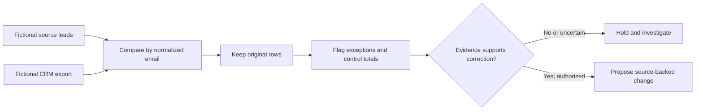

# CRM data quality, exception review and workflow design

**Hans Atherton | Public, self-directed, AI-assisted portfolio | Ontario, Canada**

A CRM record should not be deleted, merged or changed solely because a spreadsheet check flags it. This portfolio contains a **reproducible, non-destructive record-quality exercise** and two clearly separate, **unfinished** automation designs.

My paid experience is reviewing real estate agreements and supporting records, investigating discrepancies, and coordinating corrections before transaction deadlines. The code, synthetic datasets and documentation are portfolio practice, **not paid CRM administration or completed production integrations**.

Illustrative scorecard derived from generated test records and GitHub Actions results. Not a screenshot from HubSpot or any customer system. Issue categories overlap.

## Recruiter quick review

| Evidence | Open it | What can be verified |
|---|---|---|
| **Business case** | [Business case study](CRM_CASE_STUDY.md) | Business objective, control totals, exception decisions and limitations |
| **Specific exceptions** | [Five grounded record-review examples](docs/REVIEW_DECISIONS.md) | Source-versus-CRM evidence, required follow-up and why no auto-correction is authorized |
| **Calculation check** | [Count reconciliation](docs/COUNT_RECONCILIATION.md) | Why Python reports 15 unmatched valid-looking emails while SQL reports 28 including invalid addresses |
| **Runnable evidence** | [CRM analysis](02-crm-data-quality/README.md) | Fictional CSVs, non-destructive Python/SQLite analysis, committed output and automated tests |
| **Walkthrough** | [Interview demonstration guide](docs/INTERVIEW_WALKTHROUGH.md) | Short sequence to explain a discrepancy without pretending a video was recorded |
| **Independent owner review** | [Blank verification worksheet](CANDIDATE_VERIFICATION_WORKSHEET.md) | Where to record actual personal decisions and observations; **not completed** |

**Verified example:** 700 fictional source leads were compared with 733 CRM rows. All 733 CRM rows remain in the review output. The checks flag **311 distinct rows** with at least one issue, including **40 duplicate-email groups (80 rows)**. These are deliberately planted defects, not a measured customer-data quality rate.

## Project status

| Component | Status | Candid boundary |
|---|---|---|
| [CRM data-quality review](02-crm-data-quality/README.md) | **Reproducible on fictional records** | Python/SQLite checks and repeatable tests. No live CRM access |
| [n8n–HubSpot lead intake](01-lead-to-crm-automation/README.md) | **Importable blueprint; integration not verified** | Static workflow structure can be checked; none of 11 HubSpot scenarios has an observed result |
| [Power Automate design](03-power-automate/README.md) | **Design-only** | No executable cloud flow or real run results |

**Reproducibility:** GitHub Actions runs the Python record review, business-rule checks, static workflow checks and documentation validation. A passing build supports the *example*, not independent commercial QA, personally adjudicated review performance or production software tenure.

[Evidence boundaries and security audit](PUBLIC_REPO_AUDIT.md) · [AI output evaluation portfolio](https://github.com/AthertHa-FinOps/AI-Output-Evaluation-Content-Accuracy-Review)
