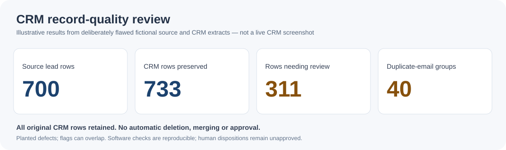

# CRM contact-data reconciliation

**Hans Atherton | Self-directed exercise | Fictional data**

In real estate transactions, I compare names, dates, figures and supporting documents with agreements and amendments. When records conflict, I follow up before contractual deadlines. This sample applies the same approach to a fictional CRM export: find discrepancies, trace the source and keep uncertain changes on hold.

## Inspect a record

The source file has **700 leads**; the CRM export has **733 rows**. The Python review preserves every CRM row and flags **311 distinct rows**. It finds **40 repeated-email groups** (80 CRM rows). These were deliberately planted defects, not a measured error rate.

| Example | Evidence | What needs deciding |
|---|---|---|
| [C00007](docs/REVIEW_DECISIONS.md) | CRM surname Patei; source L0640 says Patel | Which dated record is authoritative? |
| [C00016](docs/REVIEW_DECISIONS.md) | CRM and source L0315 have different phone digits | Which number has been confirmed? |
| [C00004 and C00522](docs/REVIEW_DECISIONS.md) | Two CRM rows share a normalized email | Are they duplicates or separate legitimate records? |
| [15 versus 28](docs/COUNT_RECONCILIATION.md) | Two checks use different rules for malformed email addresses | Which population should the report count? |

The [review CSV](02-crm-data-quality/outputs/crm_review.csv) adds flags, suggested normalized values and `matched_source_id` for records with **exactly one matching source email**. A matching email is not proof of identity or permission to edit a contact.

[Review CSV](02-crm-data-quality/outputs/crm_review.csv) · [Control report](02-crm-data-quality/outputs/control_report.md) · [Source examples](docs/REVIEW_DECISIONS.md) · [Python script](02-crm-data-quality/run_analysis.py)



<sub>Illustration, not a live CRM screenshot. A record can carry multiple flags.</sub>

## What was actually tested

| Component | Evidence | Limit |
|---|---|---|
| [CRM record review](02-crm-data-quality/README.md) | Reproducible Python and SQLite checks, preservation and edge-case tests, [GitHub Actions](.github/workflows/data-quality-tests.yml) | No approved CRM edits or independent five-case personal sign-off |
| [n8n lead intake](01-lead-to-crm-automation/README.md) | Workflow export, isolated contract checks, and a [local T03 run](01-lead-to-crm-automation/evidence/T03-2026-11-03.md) returning HTTP 422 | HubSpot create/update and ten other runtime scenarios unverified |
| [Power Automate](03-power-automate/README.md) | Design mapping | No working cloud flow |

Run the data review and checks from the repository root (Python 3.10+):

```bash
python 02-crm-data-quality/run_analysis.py
python -m unittest discover -s 02-crm-data-quality/tests -v
```

## Experience and boundaries

My paid experience is in real estate transaction documentation, record checks and correction follow-up. This project shows transferable CRM data-review methods; it is **not** paid CRM administration, a production deployment or proof of CRM user-support experience.

The fictional dataset, scripts and documentation were developed with AI assistance. The outputs can be independently inspected, but my [five-case review worksheet](CANDIDATE_VERIFICATION_WORKSHEET.md) has not been completed. No client data was used.

[Business case](CRM_CASE_STUDY.md) · [Count reconciliation](docs/COUNT_RECONCILIATION.md) · [Evidence audit](PUBLIC_REPO_AUDIT.md) · [Completion checklist](docs/COMPLETION_CHECKLIST.md)
